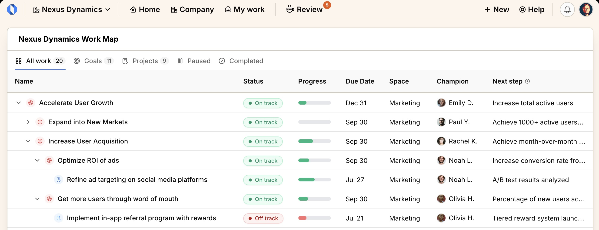

<h1 align="center">Operately</h1>

<p align="center">
  Open source company operating system
  <br />
  <a href="https://discord.gg/2ngnragJYV">Discord</a>
  ·
  <a href="https://operately.com">Website</a>
</p>

<p align="center">
  <a href="https://github.com/operately/operately/blob/main/LICENSE"></a>
  <a href="https://operately.semaphoreci.com/projects/operately"></a>
  <a href="https://github.com/operately/operately/pulse"></a>
  <a href="https://discord.gg/2ngnragJYV"></a>
</p>

## About Operately



Operately helps owners and management teams of growing businesses see how the business is performing, agree on what matters, and keep important work moving—without chasing every update.

As your business grows, keeping everything on track gets harder. You've delegated responsibilities, but you still need to chase updates, check spreadsheets, and make sure important commitments don't get forgotten.

Operately is different. Instead of being another generic project management tool, it's an **opinionated operating system** that brings goals, projects, and KPIs together, with clear ownership and regular progress updates.

Unlike tools like Notion or ClickUp, where you need build your own management system, Operately comes with a ready-made structure for running and improving your business: set goals, organize projects, track key numbers, and keep everyone accountable.

**Why switch?** Know where your business stands and where your attention is needed, without having to ask everyone individually.

## Features

- **Goals / OKRs** - Track company-wide progress with clear targets linked directly to daily work
- **Project Management** - Keep projects on track with task boards, milestones, consistent check-ins, and reusable project templates
- **KPIs** - Track your key business numbers with weekly or monthly updates, historical charts, and clear ownership
- **Work Maps** - See how goals and projects connect across your company, who's responsible, and where things stand
- **Team Spaces** - Give departments their own organized home for goals, projects, KPIs, and documents
- **Message Boards** - Replace scattered email threads with organized discussions that build shared understanding
- **Documents & Files** - Create, store, and share content in one centralized system with folders, version history, and public sharing
- **Team Management** - Onboard members and guests, manage permissions, and maintain company structure
- **My Work** - See your tasks, upcoming commitments, and items waiting for your review in one place
- **Execution Cadence** - Built-in goal and project check-ins, reminders, and retrospectives help teams establish a consistent rhythm of progress updates
- **Full-Text Search** - Find goals, projects, tasks, documents, and discussions, including past work
- **AI Executive Coach** - Get AI-powered advice on goals, project progress, and blockers using your company's context
- **CLI, API & MCP** - Give AI agents programmatic access to your company. Connect ChatGPT, Claude, and other AI tools through [MCP](https://operately.com/help/mcp-connections/), the [CLI](https://operately.com/help/cli), or the [API](https://operately.com/help/api).
- **Agent Skills** - Published [skills](https://github.com/operately/skills) for Codex and Claude Code, and for [OpenClaw](https://clawhub.ai/markoa/operately-cli)
- **Self-Hosting & Data Portability** - Run Operately on your own infrastructure and export or import your company data
- **Multiple Languages** - Use Operately in English, Portuguese, German, French, Spanish, Russian, and more.

## How it compares

| | Operately | Monday.com | Asana | Notion |
|---|---|---|---|---|
| Open source | Yes (Apache 2.0) | No | No | No |
| Goals / OKRs | Built in | Configurable boards and templates | Built in (Advanced+) | Templates and databases |
| Project management | Built in | Built in | Built in | Databases and projects |
| KPI tracking | Dedicated KPIs with update history | Boards and dashboards | Custom fields and dashboards | Databases and charts |
| Self-hostable | Yes | No | No | No |
| SaaS pricing model | Flat-rate tiers with user limits | Seat-based | Per seat | Per member |
| Progress updates | Structured goal and project check-ins | Item updates and project health | Goal and project status updates | Configurable project status tracking |
| AI agent access | MCP + CLI + API + skills | MCP + API | MCP + API | MCP + API |

Operately's main difference is its ready-made structure for running a business. Instead of building your own system for setting priorities, organizing work, and tracking performance, you get goals, projects, KPIs, and regular progress reviews working together from the start.

## Who uses Operately

Owners, founders, and management teams of growing businesses that need better visibility into performance, priorities, and progress. Particularly useful for companies with multiple teams, functions, or locations, where responsibilities have been delegated but the owner still spends too much time following up.

Works best for teams of roughly 10 to 100 people.

## Quick start

```
wget -q https://github.com/operately/operately/releases/latest/download/operately-single-host.tar.gz
tar -xf operately-single-host.tar.gz
cd operately
./install.sh
docker compose up --wait --detach
```

For more details, see [installation guide](https://operately.com/install).

## Development

- [How to contribute to Operately](CONTRIBUTING.md)
- [How to set up your development environment](docs/dev-env.md)
- [Architecture Overview](docs/architecture.md)
- [Pages, Routes and Data Loading](docs/pages-and-data-loading.md)
- [Modifying the database schema](docs/database-schema.md)
- [API](docs/api.md)
